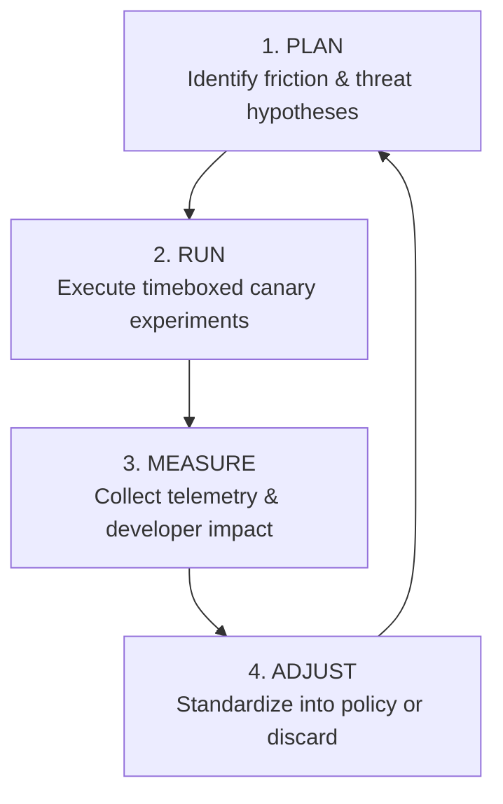

# Process: Kaizen Continuous Improvement Loop for AI-Assisted Security Workflows

## Context
Security in rapid cloud and AI-driven development environments cannot rely on static policies or infrequent point-in-time reviews. The Kaizen loop applies continuous, incremental optimization to security controls, automated tooling, and AI-assisted workflows—ensuring guardrails remain effective without bottlenecking engineering velocity.

---

## The Four-Stage Security Kaizen Loop

### 1. Plan (Hypothesis & Baseline)
- **Identify Friction or Risk:** Inspect telemetry (e.g., CI build drop-offs, false-positive alerts, new AI tool capabilities, emerging threat vectors).
- **Formulate Security Hypothesis:** Define an actionable improvement statement (e.g., *"Replacing static token scanning with AST-based secrets detection will cut false positives by 50% without missing real leaks"*).
- **Establish Baseline:** Record existing performance metrics before introducing changes.

### 2. Run (Canary Experimentation)
- **Timeboxed Pilots:** Deploy changes as non-blocking canaries or scoped pilots within a subset of repositories or agent workflows for 14–30 days.
- **Controlled Scope:** Test AI agent guardrails (e.g., automated prompt delimiters or scoped tool permissions) in non-production environments first.
- **Developer Enablement:** Communicate experiment objectives and feedback channels directly to engineering squads.

### 3. Measure (Empirical Telemetry)
- Collect objective telemetry against pre-defined success metrics.
- Gather qualitative engineer feedback (e.g., did the security gate create unexplained build failures or excessive PR latency?).
- Validate security efficacy: Did the guardrail successfully block simulated attacks or policy violations?

### 4. Adjust (Codify or Discard)
- **Adopt & Standardize:** If metrics show verified risk reduction and acceptable friction, codify the rule into the CI/CD pipeline or ADR repository.
- **Refine or Discard:** If the control yields high false-positive rates or degrades developer velocity without demonstrable security value, deprecate or redesign it. Never keep ineffective controls out of sunk-cost fallacy.

---

## Core Security Metrics List

| Metric Name | Calculation / Source | Target Benchmark |
| :--- | :--- | :--- |
| **MTTR (Mean Time to Remediate)** | Time from vulnerability detection in CI/CD to merged remediation PR | < 72 hours (Critical), < 14 days (High) |
| **Secret Escape Rate** | Number of secrets detected in `main` branch vs blocked in pre-commit | Zero escapes per quarter |
| **CI Security Gate False Positive Rate** | (Suppressed / Invalid alerts) / Total alerts flagged by SAST/SCA | < 5% false-positive ratio |
| **Agent Tool Authorization Rejections** | Number of blocked agent function calls due to invalid scopes or parameters | Monitored baseline; spikes trigger review |
| **Just-in-Time (JIT) Adoption Ratio** | Ratio of privileged sessions initiated via JIT vs permanent static accounts | > 95% across all production environments |
| **Security ADR Review Velocity** | Business days from ADR proposal to formal architecture sign-off | <= 3 business days |

---

## Anti-Patterns

- **Set-and-Forget Rules:** Writing rigid security policies or linting rules that run unmonitored for years while accumulating developer workarounds.
- **Measuring Activity Over Outcomes:** Tracking "number of scans run" instead of "reduction in exploitable production vulnerabilities."
- **Tolerating Broken Broken Windows:** Allowing a flood of known false positives to desensitize engineering teams to genuine security alerts.

---

## Checklist

- [ ] Security improvements begin with a measurable hypothesis and baseline metric.
- [ ] New automated gates run in observation mode before enforcing blocking behavior.
- [ ] False-positive rates are reviewed on a bi-weekly cadence.
- [ ] Retrospectives include both security architects and lead platform engineers.
- [ ] Successful experiments are documented as ADRs and published to the team playbook.
